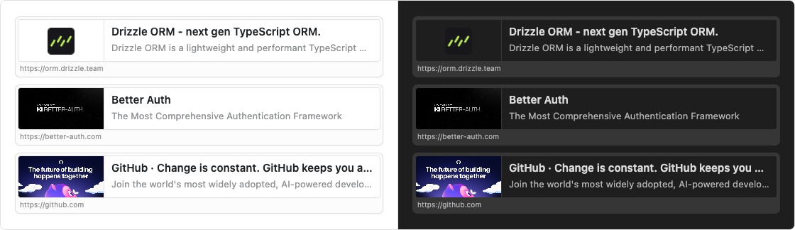

# Link Preview Cards

**Turn pasted URLs into clean, clickable preview cards in Obsidian.**  
Paste a link and it becomes an Open Graph card.

[Install](#install) · [What it does](#what-it-does) · [Use](#use)



---

## What it does

- Paste a URL with nothing selected, and it becomes a preview card.
- Keep Obsidian’s normal paste when text is selected.
- The card uses the page’s Open Graph title, description, and image.
- When a page has no preview image, the card shows the site icon instead.

---

## Install

These steps follow [Build a plugin](https://docs.obsidian.md/Plugins/Getting+started/Build+a+plugin). The plugin is loaded from your vault, so you clone it, build it, then turn it on.

Use a vault you can experiment in. Plugin development can change notes. [Create an empty vault](https://help.obsidian.md/Getting+started/Create+a+vault#Create+empty+vault) if you want a safe place to try this.

You need [Git](https://git-scm.com/) and [Node.js](https://nodejs.org/).

### 1. Download the plugin into your vault

Obsidian looks for plugins in `<vault>/.obsidian/plugins/`. The folder name has to match the id in `manifest.json`, which is `link-preview-cards`.

```bash
cd path/to/vault
mkdir -p .obsidian/plugins
cd .obsidian/plugins
git clone https://github.com/ralf-al/Obsidian-Link-Preview-Cards.git link-preview-cards
```

### 2. Build the plugin

```bash
cd link-preview-cards
npm install
npm run build
```

That writes `main.js`, which Obsidian loads together with `manifest.json` and `styles.css`.

While you are changing the source, `npm run dev` rebuilds the plugin as you save.

### 3. Enable the plugin

1. In Obsidian, open **Settings**.
2. In the side menu, select **Community plugins**.
3. Select **Turn on community plugins**.
4. Under **Installed plugins**, enable **Link Preview Cards**.

If the plugin is missing from the list, restart Obsidian. Restart again whenever you change `manifest.json`. After source changes, reload with **Command palette → Reload app without saving**, or turn the plugin off and on.

---

## Use

Paste a link such as `https://orm.drizzle.team` into a note, with no text selected. The URL is replaced by a card with the page title, description, image, and address.
